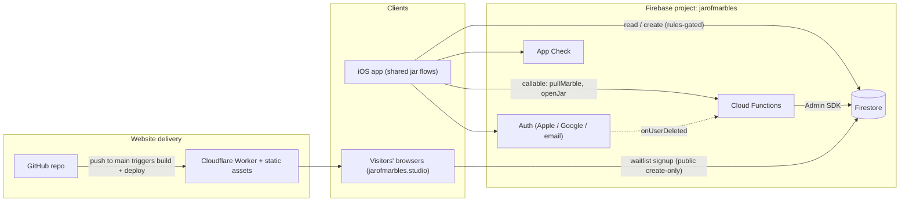
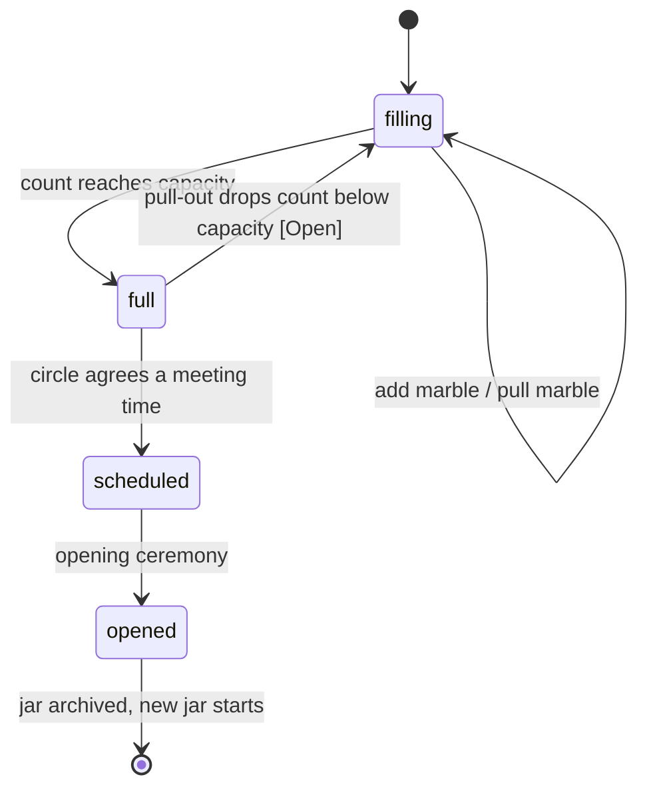

# Shared Jar: Design Doc

| | |
|---|---|
| **Status** | Draft v0.1, for review |
| **Owner** | Khem |
| **Branch** | `shared-jar` (long-lived feature branch) |
| **Last updated** | 2026-10-16 |

> **Provenance.** This repo contains the marketing website only. The description of the iOS app and its backend in section 2 is reconstructed from the app's published Firestore security rules and from product decisions made in conversation. It has **not** been checked against the app's source code. Everything under "Proposed" is a design proposal, not a description of existing behavior. Items marked **[Open]** are listed in section 10.

---

## 1. Summary

Jar of Marbles is pivoting from a **personal jar** (each person has their own jar that others drop marbles into) to a **shared jar** (one jar per circle that the whole circle fills together). This is closer to Brené Brown's original marble jar idea.

How it works:

1. People form a **circle**. One person, who starts it, **manages** the group.
2. Anyone in the circle adds **marbles** to the one **shared jar**. Each marble carries a **message**. Messages stay **sealed**.
3. If someone is hurt by someone in the group, they can **pull a marble out**. The count goes down. They must give a **reason**. They never see the message attached to the marble that is removed, and the circle never sees who pulled it.
4. When the jar is **full**, the circle decides together when to meet and **opens the jar together**. Only then are the messages (and the reasons for any pulled marbles) revealed to everyone.

This doc covers the architecture, the system view, and a high-level product spec, and lists the decisions still needed.

## 2. Current state (what exists today)

**iOS app** (Firebase-backed, inferred from Firestore rules):

- Sign-in via Firebase Auth (Apple, Google, email). App Check is in use for the app.
- Firestore collections: `users/{uid}` (with `inbox` and `incomingContacts` subcollections), `emailInvites`, `emailToUID`, `publicKeys`, `jarStatus`, `deletedUsers`.
- Marbles are **end-to-end encrypted** messages dropped into a specific person's `inbox`. The rules pin the shape to `fromUID`, `fromName`, `ciphertext`, `ephemeralPublicKey`, `style`, `dateLabel`, `createdAt`, so the crypto is an ephemeral-key scheme, and public keys live in `publicKeys/{uid}`.
- "Circle" today means mutual contacts (QR scan or email invite). `jarStatus/{uid}` exposes only a "jar is full" boolean, never a count.
- A Cloud Function (`onUserDeleted`) writes an audit record to `deletedUsers`.

**Website** (this repo):

- Static HTML/CSS/JS served as a Cloudflare Worker with static assets. Pushes to `main` deploy to `jarofmarbles.studio`. `_headers` sets the CSP and other security headers. `.assetsignore` keeps non-site files out of the deployment.
- A "notify me" modal writes signups to a public create-only Firestore collection, `waitlist`, keyed by email.
- Pages: Home (with an embedded "How it works" animation), About, Privacy, Terms.

## 3. Goals and non-goals

**Goals**

- G1. One shared jar per circle, filled by all members.
- G2. Messages stay sealed (unreadable to everyone, including the operator, to the extent the crypto allows) until the circle opens the jar.
- G3. Members can pull a marble out, with a required reason, anonymously to the circle, and without ever seeing the removed marble's message.
- G4. A full jar leads to a deliberate, shared moment: the circle chooses a time and opens it together.
- G5. Keep the app's existing privacy posture: end-to-end encrypted content, no usage or device analytics, minimal retained data, 13+ audience.

**Non-goals (for v1)**

- No chat, comments, or reactions.
- No public or discoverable circles. Membership is by invitation only.
- No web client for the jar. The website stays marketing, legal pages, and the waitlist.
- No moderation tooling beyond a report path and manager controls (see section 9).

## 4. Concepts

| Term | Meaning |
|---|---|
| **Circle** | A group of people who trust each other. Owned collectively by its members. |
| **Manager** | The person who starts the circle and manages the group. Exact powers **[Open]**. |
| **Member** | Anyone in the circle, including the manager. |
| **Jar** | The circle's single shared container of marbles. It has a capacity. |
| **Marble** | One contribution: a message plus metadata. Counted toward the jar's total. |
| **Message** | The text attached to a marble. Sealed until the jar is opened. |
| **Pull-out** | A member removing one marble from the jar, with a reason. Reduces the count by one. |
| **Reason** | Text explaining why someone pulled a marble. Sealed, then shared with everyone at opening. |
| **Opening** | The shared event after the jar is full where messages and reasons are revealed. |

## 5. High-level spec

### 5.1 Roles and permissions

| Action | Member | Manager |
|---|---|---|
| Add a marble (with message) | Yes | Yes |
| See the marble count | Yes | Yes |
| Read messages | Only at opening | Only at opening |
| Pull a marble out (with reason) | Yes | Yes |
| Invite people to the circle | **[Open]** | Yes |
| Remove someone from the circle | **[Open]** | **[Open]** |
| Propose a meeting time / open the jar | **[Open]** | **[Open]** |
| Transfer or give up management | n/a | **[Open]** |

### 5.2 Rules

- **R1.** A circle has exactly one active jar at a time. **[Open: multiple circles per person?]**
- **R2.** Any member can add a marble. A marble requires a message and is sealed on the author's device before upload.
- **R3.** All members can see the current marble count. No one can read any message before opening.
- **R4. Pull-out.**
  - Any member can pull a marble. A reason is required.
  - The puller never sees the message attached to the marble that is removed, and the count decreases by one. *(Decided.)*
  - The circle cannot see who pulled. The reason is stored sealed and is revealed to all members at opening. *(Decided.)*
  - *(Assumption)* The system chooses which marble is removed, at random, so the puller cannot choose or learn what it said. **[Open: confirm]**
  - *(Assumption)* The removed marble's message is discarded and never revealed to anyone, including at opening. **[Open: confirm]**
- **R5.** The jar is **full** when the count reaches its capacity N **[Open: N and who sets it]**.
- **R6.** When the jar is full, the circle agrees on a meeting time. The app records and reminds, but does not enforce physical attendance **[Open: scheduling mechanism]**.
- **R7.** At opening, all remaining messages and all pull-out reasons are revealed to all members at once. The jar is then archived and a fresh jar starts.
- **R8.** Minimum age 13 (matches the Privacy Policy).
- **R9.** Account deletion removes the person's profile data. Their email is retained for administrative purposes only (matches the Privacy Policy). What happens to their marbles **[Open]**.

### 5.3 Core flows

1. **Create a circle.** Manager creates a circle, invites people (QR or email, reusing the existing invite patterns), and the jar starts empty.
2. **Add a marble.** Member writes a message, taps "Drop it in". The message is sealed on-device. The count goes up for everyone.
3. **Pull a marble out.** Member taps "Pull one out", writes a reason, confirms. The system removes a random marble. The member sees only that the count went down.
4. **Jar becomes full.** Members are notified **[Open]**. They propose and agree on a time to meet.
5. **Open the jar.** At or after the agreed time, the jar is opened. Messages and reasons become readable to every member. The circle reads them together.

### 5.4 Edge cases to decide

- A pull-out drops the count below capacity while the jar is "full" and a meeting is scheduled: does the jar revert to filling?
- A member leaves or is removed: do their marbles stay in the jar?
- The manager leaves or deletes their account: who takes over?
- The last member leaves: the jar and its data are deleted.
- Abuse: one member repeatedly pulling marbles. Rate limits, or a cap per member per jar?
- A new member joins after marbles exist: they must not be able to read earlier messages before opening, and the crypto design must allow late joiners (see 7.3).

## 6. System view



**What is new for the shared jar:** the `circles` data model (7.1), the `pullMarble` and `openJar` callable functions, jar-state logic, and the sealed-message key scheme (7.3). Auth, App Check, the invite flows, the public-key directory, and the website pipeline already exist.

## 7. Architecture (proposed)

### 7.1 Data model

Firestore (names are placeholders). Writes that must be consistent (the marble count, state changes, pull-outs) go through Cloud Functions or transactions so clients cannot forge them.

```
circles/{circleId}
  managerUID        string
  state             "filling" | "full" | "scheduled" | "opened"
  capacity          number            // N [Open]
  marbleCount       number            // maintained server-side only
  meetingAt         timestamp | null
  createdAt         timestamp
  sealPublicKey     string            // circle public key; marbles are encrypted to it

circles/{circleId}/members/{uid}
  role              "manager" | "member"
  joinedAt          timestamp

circles/{circleId}/marbles/{marbleId}
  ciphertext        string            // message sealed to the circle key
  ephemeralPublicKey string
  createdAt         timestamp
  // authorUID deliberately not stored in client-readable form [Open]

circles/{circleId}/pulls/{pullId}
  reasonCiphertext  string
  ephemeralPublicKey string
  createdAt         timestamp
  // no puller identity stored (see 7.4)

circles/{circleId}/seal/{uid}          // member's wrapped copy of the circle private key
  wrappedKey        string            // readable only when state == "opened"
```

Existing collections keep working. Marbles move from `users/{uid}/inbox` into `circles/{id}/marbles`. `publicKeys/{uid}` is reused for wrapping keys to members.

### 7.2 Jar lifecycle



State transitions are performed by Cloud Functions, never directly by clients.

### 7.3 Sealed messages (the hard design problem)

**Requirement.** Marbles must be encrypted on the author's device. Nobody (members, manager, operator) can read them until the jar is opened, and then every member can read all of them.

**Constraint.** The existing scheme encrypts to one recipient's public key (`ephemeralPublicKey` plus `ciphertext`). A shared jar needs a key the whole group can obtain only at opening.

**Options**

| | Approach | Pros | Cons |
|---|---|---|---|
| **A** | Per-circle keypair. Marbles are encrypted to the circle public key. The private key is wrapped to each member's public key and **stored server-side but only released by rules when `state == "opened"`**. | Reuses the existing ephemeral-key pattern. Late joiners are simple. | "Sealed" relies on the server honoring the gate. Whoever generates the circle private key (the manager's device) briefly holds it unless it is generated server-side or immediately wrapped and discarded. |
| **B** | Threshold secret sharing (e.g., Shamir). The circle private key is split across members, and a quorum must come together to open. | Cryptographically enforces "open together". No single party can open early. | Complex. Late joiners and departures need re-sharing. Needs all or most members online and cooperating. |
| **C** | Key held by a server-side KMS, released by a Cloud Function at opening. | Simple. The manager never holds the key. | The operator can technically open early. Weakest on the "sealed even from the operator" goal. |

**Recommendation.** Start with **A**, generating the circle key in a way that no single member holds it in plaintext (wrap to members and discard on the creator's device). Treat **B** as a later hardening step if "cryptographically cannot open early" becomes a product promise. This needs a proper crypto review before launch, and the marketing copy should not claim stronger guarantees than the shipped design provides.

### 7.4 Anonymous pull-out

- Pull-outs go through a callable function, `pullMarble(circleId, reasonCiphertext)`.
- The function verifies caller membership and rate limits, picks a random marble with the Admin SDK, deletes (or tombstones) it **without ever returning its content to the caller**, decrements `marbleCount`, and writes the reason to `pulls`.
- The `pulls` document stores no puller identity, so other members cannot tell who pulled.
- **Trade-off [Open].** Rate limiting needs some memory of who pulled. Options: store only a salted hash used for limiting and delete it at opening, or keep limits per day in a counter that is not per-user. Decide how strong the anonymity promise is: "anonymous to the circle" (easy) versus "anonymous even to the operator" (hard, conflicts with abuse limits).

### 7.5 Security rules approach

Follow the patterns already used in the app's rules:

- Allow-listed field names and size caps on every create.
- `createdAt == request.time` on client-written documents.
- Membership checks via `exists(/databases/$(database)/documents/circles/$(circleId)/members/$(request.auth.uid))`.
- No client writes to `marbleCount`, `state`, or `pulls`. Those are function-only.
- `seal/{uid}` readable only by that user and only when the parent circle's `state == "opened"`.
- `marbles` and `pulls` contents are ciphertext, so reads can be allowed to members without exposing plaintext. Reads of authorship are not possible by design.

### 7.6 Consistency and scale

- `marbleCount` is maintained inside a transaction (or by the function) so concurrent adds and pulls cannot overshoot capacity or race the `filling` to `full` transition.
- Circles are small groups, so there is no scale concern at this stage. Per-circle subcollections keep reads cheap.

### 7.7 Notifications

The current product deliberately avoids notifications. A shared jar likely needs at least "the jar is full, time to meet". **[Open: push notifications, or in-app only?]**

### 7.8 Migration from personal jars

Existing personal-jar data (`users/{uid}/inbox`, `jarStatus`) has no shared equivalent. Options: (a) leave it read-only until the app update, then retire it; (b) migrate each person's existing circle contacts into a first shared circle. Which applies depends on how many real users exist today, since the app is in internal testing. Likely the simplest answer is a clean break. **[Open]**

## 8. Website scope on this branch

| Item | Status |
|---|---|
| About page: describe shared jar, pull-out, opening, circle | Drafted (uncommitted edits in `about.html`) |
| Home page: "How it works" copy | Drafted (uncommitted edits in `index.html`) |
| Home page: hero line | Unchanged (still accurate) |
| "How it works" animation (`how-it-works.html`) | **Out of date.** Shows personal jars and private messages. Needs rebuilding for the shared flow. |
| Privacy Policy | **Needs updating.** It says marbles are added "for" individuals. It must cover circles, sealed messages, pull-out reasons shared at opening, and the manager role. |
| Terms | **Needs review.** Content in the shared jar, behavior between members, and the pull-out feature. |
| Waitlist modal copy | Unchanged |

**Deploy caution.** `main` is the live site. Merging shared-jar copy to `main` before the app ships would describe a product people cannot yet download. Decide when `shared-jar` merges to `main` (see section 10). Pushes of non-production branches may create Cloudflare preview builds, so keep sensitive details out of this branch's public files. This doc lives in `docs/` and is excluded from the deployment via `.assetsignore`.

## 9. Privacy, safety, and trust

- **Audience.** 13+, including teens. Pull-out reasons can describe being hurt by a friend or family member, so the reason field needs clear guidance and a path to get help or report.
- **Anonymity promise.** Define it precisely (7.4) and use that exact wording in the app and on the website.
- **Sealed content.** Members cannot see what others wrote until opening, so someone could be surprised by a hurtful message. Consider a report option during opening and a manager control to archive or skip a jar.
- **Data minimization.** No device or usage analytics. Messages and reasons are stored only as ciphertext. The retained email on account deletion remains as stated in the Privacy Policy.
- **Deletion.** Define what a deleted account does to its marbles and to a circle it manages.
- **Legal.** Update the Privacy Policy and Terms before launch, and consider legal review as noted in the README.

## 10. Open questions

Each has a suggested default to keep things moving.

1. **Manager powers.** What exactly can the manager do (invite, remove, schedule, archive)? *Suggest:* invite and remove members, nothing else. Decisions about meeting and opening belong to the circle.
2. **Capacity N.** Fixed number, or set by the manager, or scaled to circle size? *Suggest:* manager picks from a few presets at creation.
3. **Multiple circles.** Can a person belong to more than one? *Suggest:* yes, each with its own jar.
4. **Late joiners.** Can someone join after marbles exist? *Suggest:* yes before the jar is full, and they read everything at opening.
5. **Attribution.** At opening, is each message attributed to its author or anonymous? *Suggest:* attributed (it is a thank-you), unless this conflicts with the pull-out anonymity story.
6. **Pull-outs after full.** Allowed? Does it revert to filling? *Suggest:* allowed until scheduled, then locked.
7. **Opening mechanics.** Who triggers it, and must everyone be present? *Suggest:* any member after the agreed time, with the app encouraging doing it together rather than enforcing it.
8. **Scheduling.** In-app proposal and confirmation, or just a note? *Suggest:* simple propose-and-confirm.
9. **Operator-level anonymity.** See 7.4.
10. **Account deletion.** Do a deleted member's marbles stay? *Suggest:* yes, since the message belongs to the circle's story.
11. **Notifications.** See 7.7.
12. **Branch strategy.** When does `shared-jar` merge to `main`, given `main` is the live site? *Suggest:* after the app is in TestFlight/App Store, and until then keep website changes on this branch.

## 11. Suggested phasing

| Phase | Scope |
|---|---|
| **0. Sign-off** | Resolve section 10. Finalize the anonymity wording and crypto approach. |
| **1. Backend** | Data model, rules, `pullMarble` / `openJar` functions, tested in the Firebase emulator. |
| **2. App** | Create circle, invite, add marble, pull-out, schedule, open. |
| **3. Crypto review** | Review the sealed-message scheme before any real data. |
| **4. Website** | Rebuild the animation, update Privacy and Terms, finalize copy. |
| **5. Release** | Internal testing, migration or clean break (7.8), merge to `main`, ship. |
